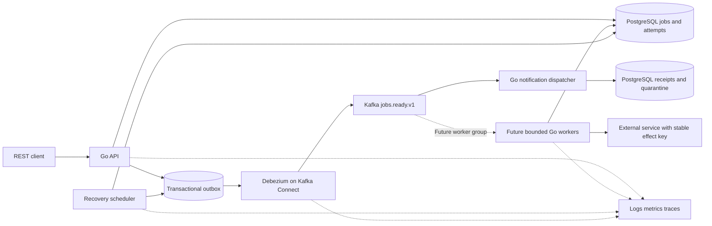
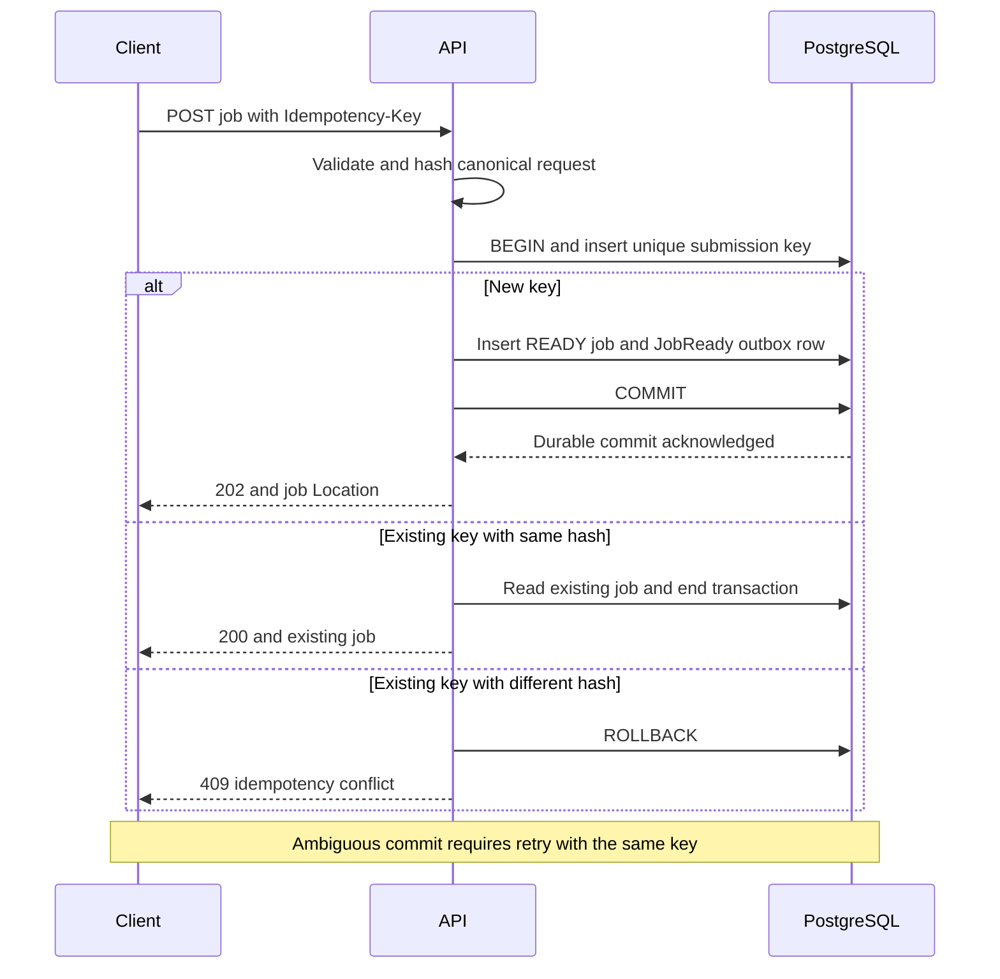
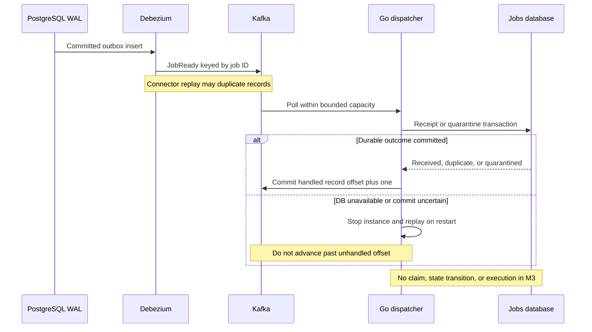
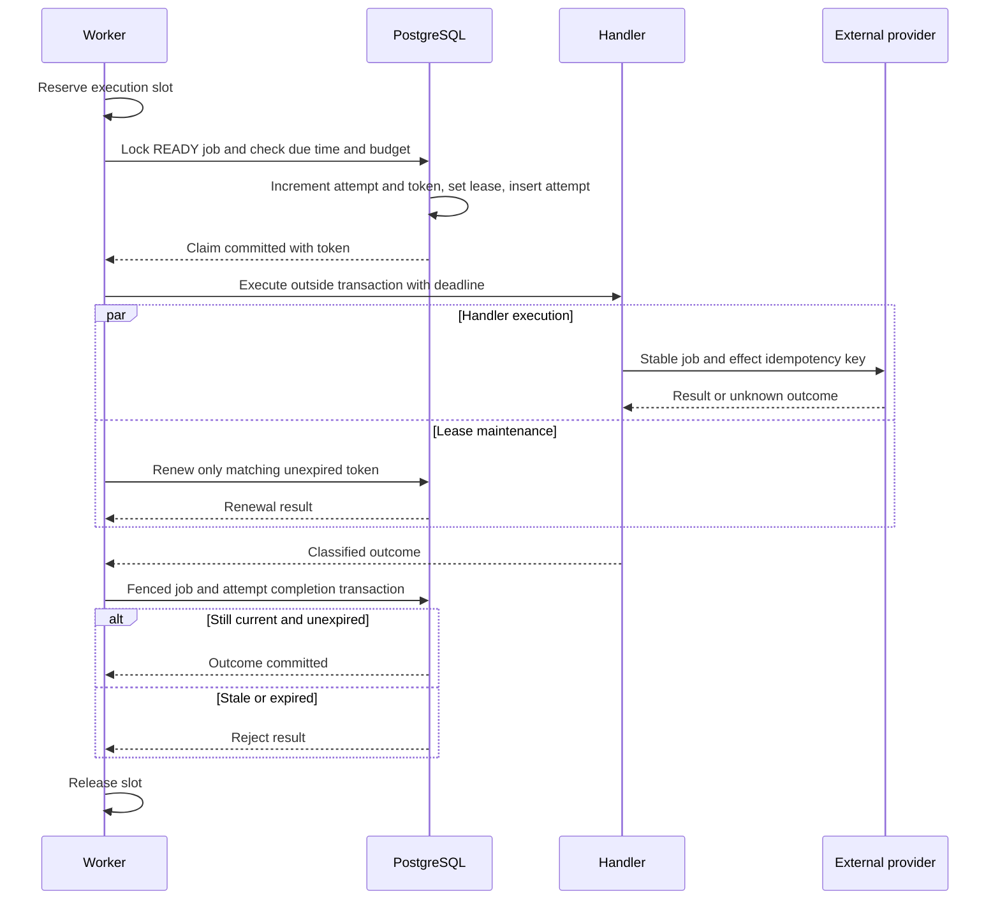
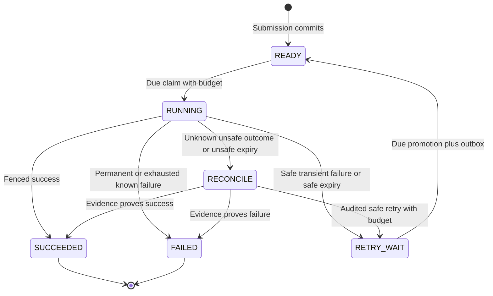
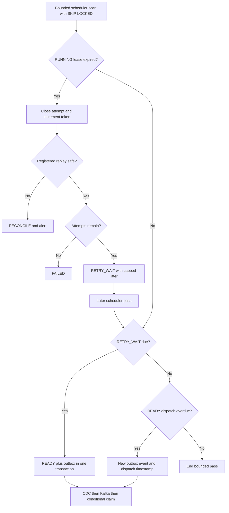
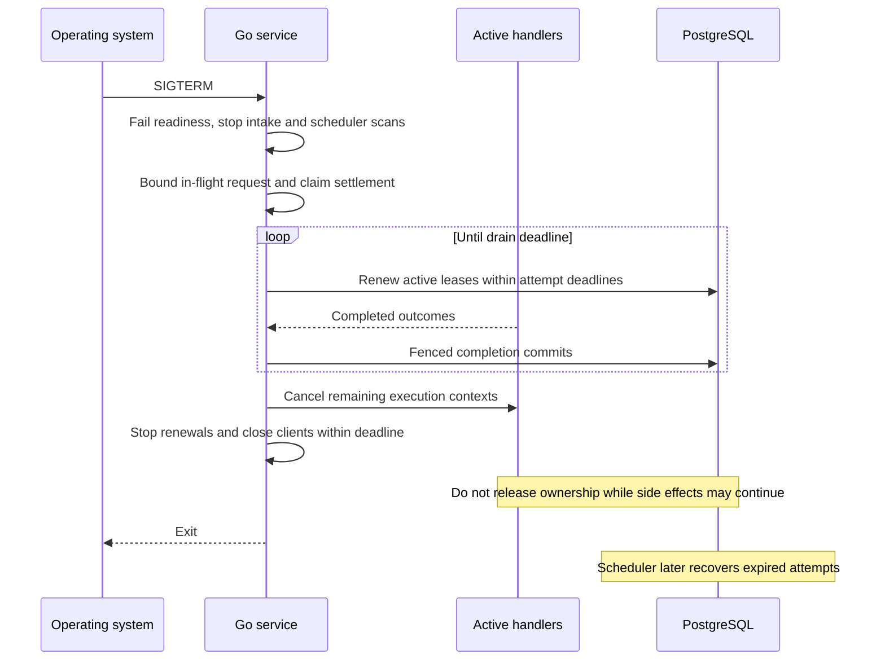

# Architecture diagrams

Proposed Phase 0 design. Standard Mermaid blocks are intended for GitHub Markdown.
All state changes are PostgreSQL transactions; dotted edges denote observations.

## Full system architecture

Jobs and outbox are tables in the same PostgreSQL database. There is no atomic
transaction across PostgreSQL, Kafka, and the external provider.

## Job submission and transactional outbox

## CDC and Kafka dispatch

Malformed records follow durable quarantine before offset acknowledgement, as
specified in the architecture document; they never authorize execution.

## Worker job claiming and execution

No execution occurs if claim fails. An ambiguous claim must be resolved by
reading the attempt identity before starting the handler.

## Job lifecycle state machine

Expired replay-safe attempts with exhausted budgets transition to FAILED.
RUNNING transitions require current unexpired ownership except scheduler expiry
recovery. Terminal states do not accept claims or subsequent result updates.

## Lease expiry, recovery, and retries

## Graceful shutdown

